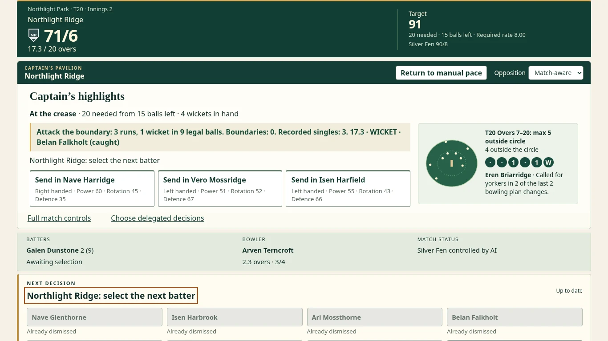
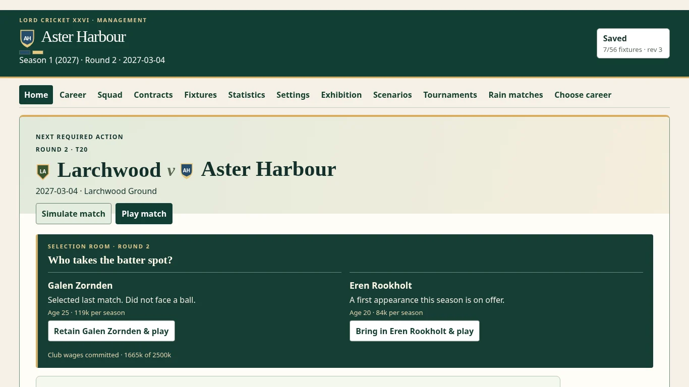

# Play the Captain’s Pavilion

Open **Scenarios → Death-overs chase** to captain Northlight Ridge. You start on 68/5 at 16 overs, chasing 91. For the reverse problem, open **Nineteen to defend**. Each restart restores the recorded checkpoint.

## At the crease and in the field

Read the target, balls and wickets in the score strip. Choose a batting intent, set a bowling plan or keep the current plan. Protecting a striker displays the rate you would need if the next three balls were dots. At a wicket, compare the incoming batters’ power, rotation and defence. At a change of bowler, compare short and long workloads, allocation left and recorded deliveries. The penultimate-over choice identifies who can still bowl the last over. **Full match controls** opens the complete XI and custom tactics.

A passage advances one accepted delivery at a time. You can stop after the current command. A wicket, an outstanding selection you retained, a rise of two runs per over in the required rate, the last two overs or the end of a two-over passage returns control. Choose **Choose delegated decisions** to hand individual calls to the assistant for your club. Delegation uses the match’s existing durable journal.

The field map shows actual placements. The delivery strip shows the latest six recorded outcomes. After a passage, the scorebook supplies the runs, wickets, legal balls and boundaries. Recorded singles, drops and decisive deliveries come from the highlight feed. A wicket can follow a defensive plan or an attacking one. The recap reports what happened.



## Reading the other captain

In T20 highlights, some captains attack new batters and others hold back a bowler with a small allocation left for the death. The scouting note appears once the captain has repeated an observed call. **Match-aware** also weighs fatigue, remaining legal overs and the public chase rate. Both settings use the same batting and bowling model.

Limited-overs exhibitions and managed T20 fixtures offer **Play captain’s highlights** alongside manual play. The close-finish challenges open in highlights. Five-day matches use their existing pace and tactical controls.

## The next fixture

On career Home, finish a managed club fixture and advance to the next match day. Where two eligible players can fill the same place, the selection room offers the regular pick and an available reserve. The regular’s previous scorecard, the reserve’s season appearances, ages and available contract figures give the choice context. Choosing a player opens the match with that XI. The captain, wicketkeeper and required bowling cover are protected.



Return the result to career. **Last time out** shows the backed player's actual figures, including a match in which they did not face a delivery. The XI and scorecard are durable career records. The reminder of whom you backed is a browser-local preference keyed by save, season and fixture.

## Reproduce the checks

Run the production build, then run the focused browser tests.

```sh
npm run build
npx playwright test --config playwright.ui.config.ts --grep 'Close finish|The captain can stop|A selection from Home|desktop essential' --reporter=list
```

The two fixed checkpoints cover batting and bowling, recaps and restarting. The career test simulates round one, chooses a replacement in round two, plays the fixture and checks Home again after reloading. The layout test covers 150% text, narrow viewports and reduced motion.
