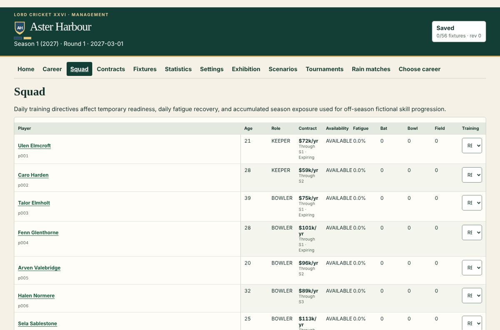
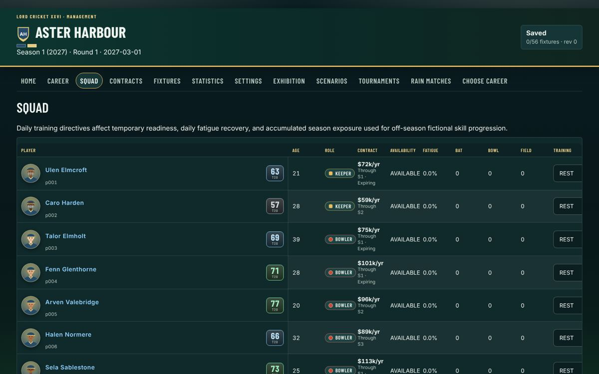
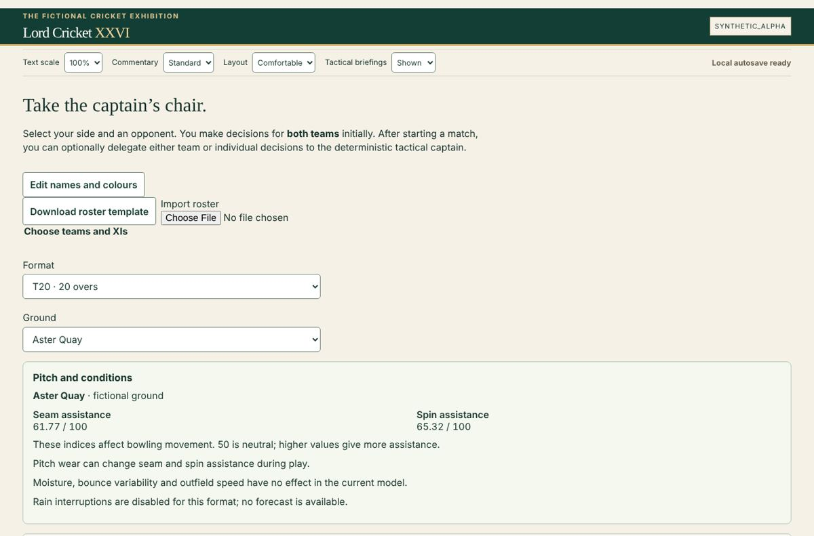
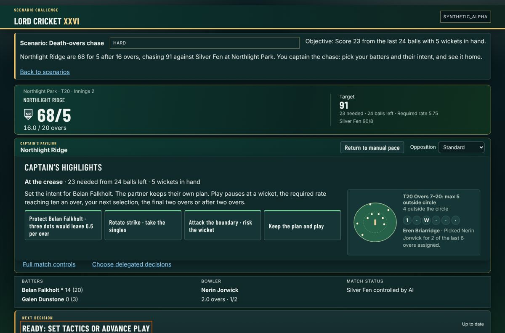
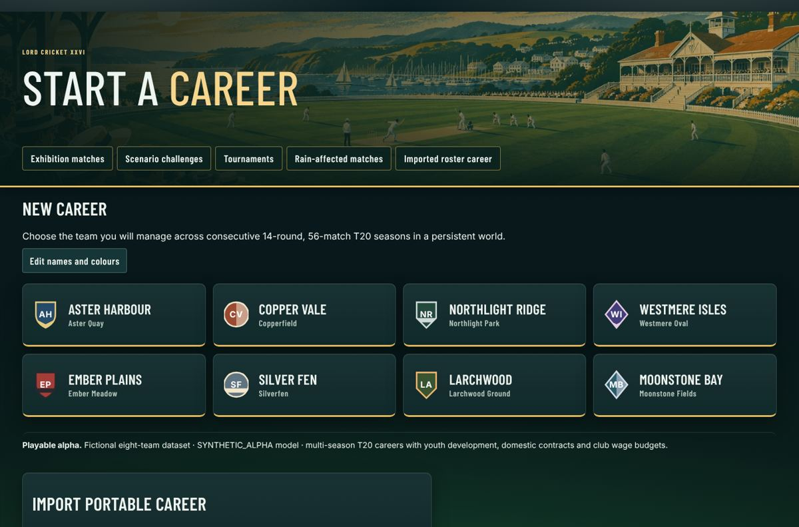
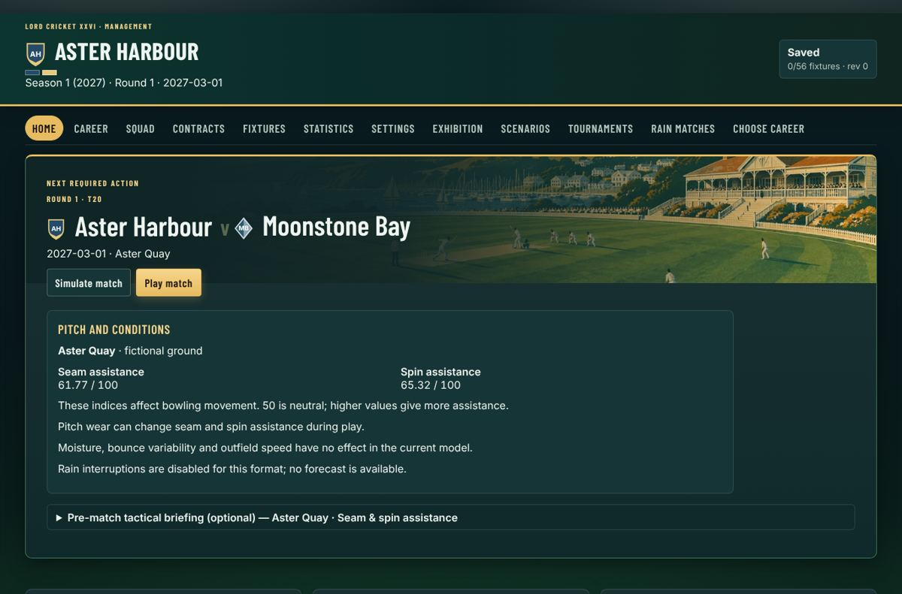
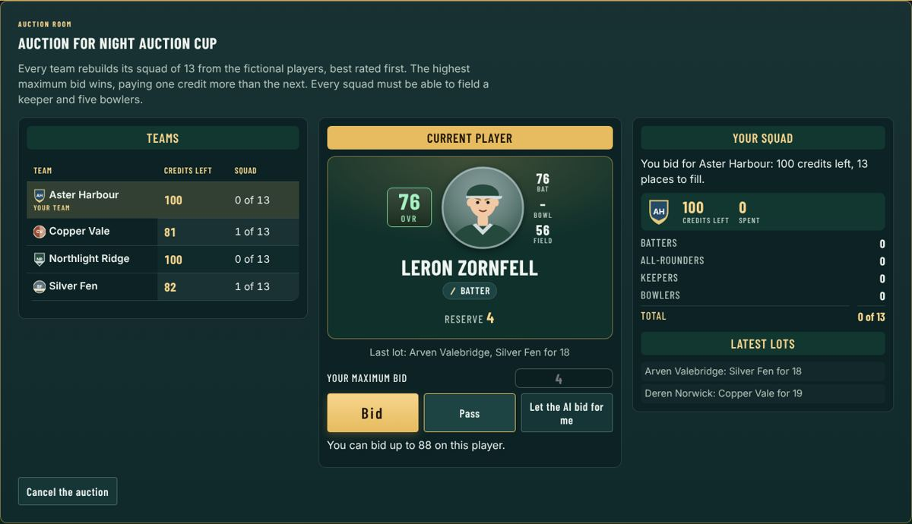

# Visual overhaul: before and after (20 November 2026)

Phases 1 to 3 of [the plan](../design/VISUAL_OVERHAUL_PLAN.md), captured in Chromium at 1366 or 1440 pixels wide from a production build.

| Screen | Before | After |
| --- | --- | --- |
| Squad |  |  |
| Exhibition and match |  |  |
| Start screen | |  |
| Career home | |  |
| Auction room | |  |

Checks on the branch: `npx tsc -b`, `npm run typecheck`, lint, `tests/unit/player-visuals.test.ts`, and the full Chromium browser suite (89 of 89, including the WCAG AA contrast audit and the 150% and 200% zoom checks). Firefox runs in hosted Windows CI.

Not done yet (later phases): player cards on more screens, the match screen's batter and bowler cards, ground illustrations for the other seven grounds, motion polish, and a person playing it.
